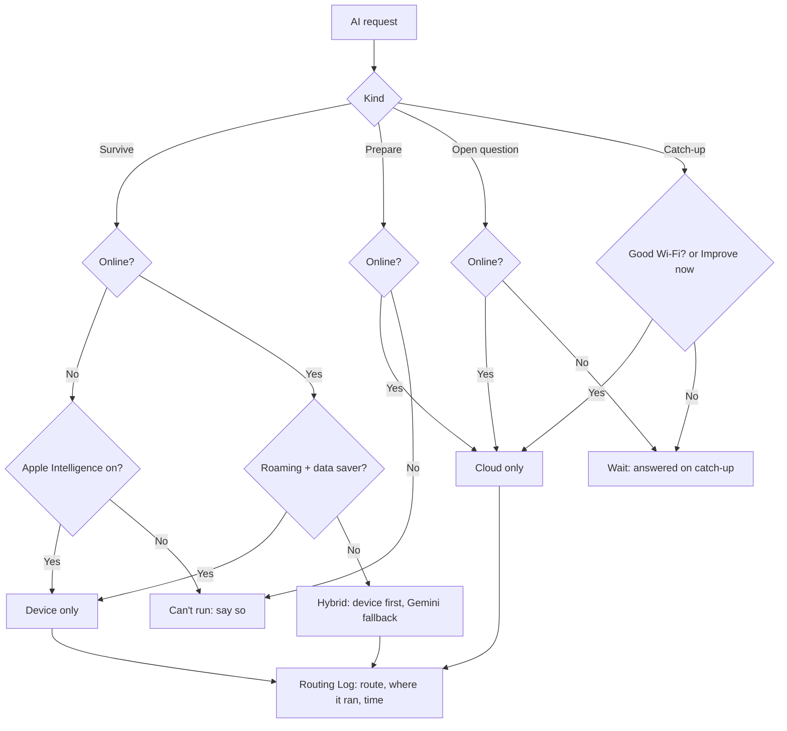

# Travel Copilot

**Your trip, even with no signal.** An iOS travel companion for #BuildHybridAI 2026 that keeps your bookings, plans and emergency information on the phone, runs AI on the device first, and uses the cloud when it needs to, including later, once you're back online.

Built with SwiftUI, SwiftData and **Firebase AI Logic** (Apple's on-device foundation model + Gemini in the cloud), with **Firebase App Check** and **Firebase Authentication**.

> Licensed under Apache-2.0. Setup steps: [SETUP.md](SETUP.md). Design rules and screens: [DESIGN.md](DESIGN.md).

---

## What it does

The app follows a trip through three stages:

| Stage | Where AI runs | What happens |
|---|---|---|
| **Prepare** (on Wi-Fi, once) | Cloud · Gemini | Paste booking emails → the cloud reads them into a **Vault** of bookings, builds a phrase and safety pack, finds your places and saves an offline map. An **AI trip planner** can suggest a destination, an outline and real places first. |
| **Survive** (anywhere, offline) | On the device first | **Blue**, the trip chat, answers from your saved bookings; **Say** translates for you; the **taxi card**, **step-by-step journey Live Activity**, trip reminders, map and **emergency card** all work with no signal. |
| **Catch up** (back online) | Cloud · Gemini | Translations made offline are drafts. When a good connection returns, Gemini reviews them and the **same chat bubble improves itself**; questions you asked offline get answered. |

### Main features
- **Blue**: a Messages-style chat. Booking questions are answered on the device from stored fields; open questions ("Where can I eat nearby?") go to Gemini with a clear **Cloud** label, or wait until you're back online.
- **Say in the local language**: context-aware translation (situation, politeness, medicine names), a full-screen card to show someone, and a reply screen for them.
- **Catch-up pass**: offline drafts reviewed in the cloud, with what changed shown in the chat and the Log.
- **Emergency info card**: a 5-question setup (blood type and medications can come from the Health app, with permission), shown full screen in the local language with English underneath, and the local emergency number one tap away.
- **Journey Live Activity and reminders**: step by step from landing to hotel check-in (train → bus → walk), with Done and Ask Blue buttons.
- **Routing Log**: every AI request with where it actually ran, how long it took and why, exportable as CSV.

---

## How Firebase AI Logic is used

Every AI call goes through one gateway, [`AIService`](ios/TravelCopilot/AI/AIService.swift), which asks a routing policy where the task should run, calls Firebase AI Logic through [`ModelRouter`](ios/TravelCopilot/AI/ModelRouter.swift), and writes the result to the Routing Log.

`ModelRouter` uses the three setups the iOS SDK offers:

| Route | Firebase AI Logic | Used for |
|---|---|---|
| **Hybrid** | `.hybridModel(primary: .systemModel(), secondary: .geminiModel(...))` | Survive tasks online: Apple's on-device model first; Firebase falls back to Gemini if the device model can't start or a request fails |
| **Device only** | `FirebaseAI.SystemLanguageModel.systemModel()` | Survive tasks offline, or on roaming with data saver on |
| **Cloud only** | `GeminiModelProvider.geminiModel(name: "gemini-3.5-flash-lite")` | Prepare, catch-up, open questions, the emergency card's one-time translation; Google Maps grounding in the planner |

Each request is single-turn (a new `GenerativeModelSession` per call) and uses structured output (`@Generable`), which works on both the device and the cloud.

### The routing policy
[`RoutingPolicy`](ios/TravelCopilot/AI/RoutingPolicy.swift) decides by task kind, connection and cost. It's a plain function, unit-tested on its own.



### Where each AI task runs

| Task | Kind | Runs on | File |
|---|---|---|---|
| Blue reads your question (which booking and field) | Survive | Device first | [`AskService.swift`](ios/TravelCopilot/AI/AskService.swift) |
| Say: translate out / translate a reply in | Survive | Device first | `AskService.swift` |
| Planner: turn a past trip into likes and dislikes | Survive | Device first | [`PlanService.swift`](ios/TravelCopilot/AI/PlanService.swift) |
| Read booking emails, build the phrase pack | Prepare | Cloud | [`PrepareService.swift`](ios/TravelCopilot/AI/PrepareService.swift) |
| Planner: destinations, day outline, real places | Prepare | Cloud (+ Google Maps grounding, Apple Maps fallback) | `PlanService.swift` |
| Blue: open questions | Open | Cloud, or wait offline | [`BlueOpenQuestions.swift`](ios/TravelCopilot/AI/BlueOpenQuestions.swift) |
| Catch-up: review offline drafts, answer waiting questions | Catch-up | Cloud | [`CatchUpService.swift`](ios/TravelCopilot/AI/CatchUpService.swift) |
| Emergency card: translate your own words once | Prepare | Cloud | [`EmergencyTranslator.swift`](ios/TravelCopilot/Emergency/EmergencyTranslator.swift) |

---

## What's done by code, not AI (the harness around the models)

The models are wrapped in code that decides what they may do and checks what they return:

- **Blue never writes booking facts.** The on-device model only picks which booking and which field a question is about; [`AskResolver`](ios/TravelCopilot/AI/AskService.swift) then shows the stored value. Rules in code make sure it never shows a value that doesn't answer the question: things bookings rarely hold (seat, gate, Wi-Fi) get "not in your bookings", places are found by name, small talk gets a help reply, and a time question needs a subject ("what time does the **hotel**…").
- **Draft on the device, reviewed in the cloud.** The catch-up pass sends offline drafts to Gemini; [`SafetyCheck`](ios/TravelCopilot/AI/CatchUpService.swift) keeps the draft if a number, dose or medicine name changed ("Check this").
- **No AI in the emergency path.** Emergency numbers are a bundled table. The emergency card's labels and common allergies and conditions are pre-translated. Only the traveler's own words are translated, once, and a translation is kept only if every number survives and medicine names keep their English name.
- **Fixed fields from bookings.** Prepare turns raw emails into a short Vault of fields, so the on-device prompt only carries booking titles (a few hundred tokens), well inside the on-device context.
- **Everything is logged.** Every call becomes a `RoutingEntry` (route requested, where it ran, latency, reason, result); the Log tab shows it, compacts older days into daily totals, and exports CSV.

### Privacy
Bookings, chats, the emergency card and the Routing Log are stored on the phone (SwiftData) and never synced. Open questions send Gemini only the trip's country, hotel name, area and dates, never booking codes or phone numbers. The Health app is read-only and only for blood type and the medications you choose to share.

---

## Numbers so far

Measured in the iPhone 17 simulator on a Mac (not yet on a real iPhone):

- **Blue question test set:** 67 real questions against the on-device model, scored by what Blue would show. **67/67 correct, 0 wrong values**, about 1.1 s per question, all on the device. Before the code rules it was 28/40 with 6 wrong values. Run it yourself: see [SETUP.md](SETUP.md#blues-question-test-set).
- **Catch-up:** an offline draft improved in the cloud in 1.3–1.7 s; the safety check passed numbers and medicine names.
- **Cloud fallback:** a translation too long for the on-device model failed on the device and Firebase answered with Gemini (hybrid route, ran in the cloud). On a phone without Apple Intelligence, every Survive request falls back this way.
- **Unit tests:** 107 passing (`xcodebuild test`), covering routing, Blue's rules, the safety check, catch-up, reminders, the journey, the Log, the emergency card and its quick access, retrying busy Gemini calls, skipping bookings already saved, keeping Health data off the cloud, the planner (dates, budget, photo taste, day stops) and reading files on the iPhone.

---

## Run it

Requirements: Xcode 26+, iOS 26 simulator or device, [XcodeGen](https://github.com/yonaskolb/XcodeGen). On-device AI needs Apple Intelligence (iPhone 15 Pro or later, or a Mac with Apple Intelligence for the simulator).

```bash
cd ios && xcodegen generate && open TravelCopilot.xcodeproj
```

Add your own `GoogleService-Info.plist` and register the App Check debug token printed on first launch; [SETUP.md](SETUP.md) has every step, plus debug launch switches for each screen.

## Project layout

```
ios/
  TravelCopilot/
    AI/          AIService · ModelRouter · RoutingPolicy · Ask · Plan · Prepare · CatchUp · open questions
    Emergency/   emergency card data, fixed translations, Health reader, translator, emergency numbers
    Features/    screens (Home, Trip, Map, Prepare, Log, Blue chat, Help, Welcome, emergency card)
    Store/       SwiftData models, trip timeline, journey, reminders, Routing Log
  TravelCopilotWidgets/   journey Live Activity, emergency card control and Lock Screen widget
  TravelCopilotTests/     unit tests + Blue question test set
```

## Status

Built and checked in the simulator: everything above. Quick access to the emergency card (Siri, Spotlight, Action Button, Control Center, Lock Screen widget) is built but needs a real iPhone to try. Not done yet: testing on a real iPhone, TestFlight, an Apple Wallet pass.

Privacy policy: [PRIVACY.md](PRIVACY.md)
